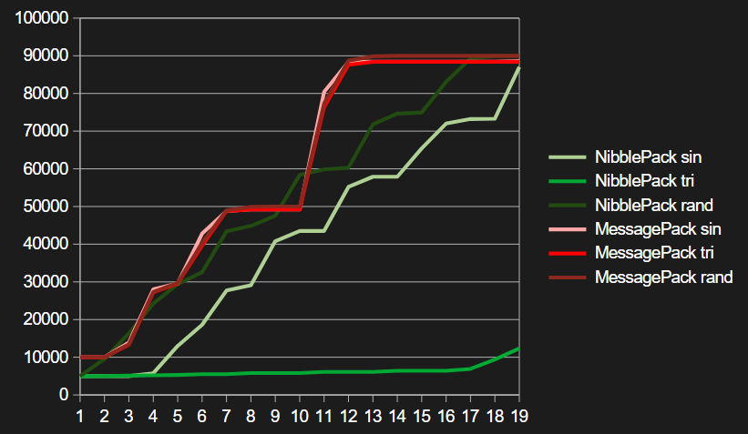
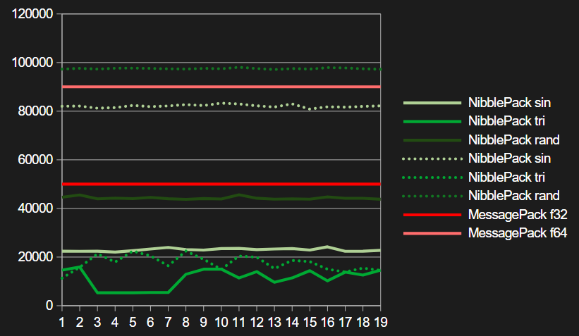

# NibblePack

A schema-less binary serialization format, focused on second-order delta compression, nibble-compact encoding, and single-pass flow.  
The wire format is specified in [specification.md](docs/specification.md).

> Current status: the first experimental release.  

## Benefits and features

- Single-pass write and read, no intermediate DOM, no two-phase encoding.
- Compact nibble-based format (nibble = 4 bits), variable-length numbers, End-terminated containers (array & map), NUL-terminated UTF-8 strings, size-prefixed raw bytes.
- Second-order delta encoding (delta-of-delta) for ints and floats (useful for time-series), with automatic fall-back to absolute values, when it is cheaper.
- Optional rounding for floats, which significantly compacts float-data when precision is excessive (default tolerance is 0.01 %, can be set at any time).  
  The per-sample guarantee: `|decoded - original| <= tolerance * |original|`.
- Gorilla-like packing for floats:
  - float => delta-of-delta => optional tolerance => XOR with previous => variable-length bits
  - variable-length bits => XOR with previous => delta-of-delta => float

## Measurements

Comparison of packing of data with three patterns:
- sin: classic sine, as an average data.
- tri: triangle, the easiest dynamic data for delta-coding.
- rand: random noise, the hardest dynamic data for delta-coding.

| Float algorithm | Lossy compression | Lossless compression | Decode | Random access | Best for |
|---|---|---|---|---|---|
| **NibblePack** | 1.8-7.2x, **per-sample drift budget** | **0.8-4.6x** | **very fast** | chain replay | general time series, streaming |
| Gorilla (2015-08) | - | 1-1.4x<br>(12x on paper's pairs) | **very fast** | chain replay | general time series |
| Chimp (2022-07) | - | 1-1.8x | **~2x faster decode than Gorilla** | chain replay | general time series |
| Elf (2023-03) | - | 0.9-1.7x;<br>~2.5x on 2-decimal prices | fast | chain replay | general time series |
| ALP (2024-06) | - | 1.1-1.5x;<br>zstd-level on decimal columns | **SIMD/GPU-friendly, ~10x faster decode than zstd** | **O(1) by bit offset** | decimal-heavy columnar data |
| Dolphin (2026-02) | - | 1-1.7x | fast | chain replay | general time series |
| SZ3 (2023-04) | **10-100x**, **error bound** | - | medium | block | scientific arrays |
| ZFP (2014-12) | preset rate, **error bound** (e.g. 4-16 bits/value) | - | **very fast** | block | scientific grids |
| LeCo (2024-06) | - | strong on correlated series | fast | block | offline block storage |

Ratios are corpus-averaged over described patterns, on the same basis (bytes vs raw float64).


Packing of int values, bytes on the Y-axis, amplitude on the X-axis (e.g.: 3 is ±100, 4 is ±1000, 19 is ±1e+18).  
Each horizontal step is a 10'000-point packet, and multiplies the amplitude by 10; sin and tri have a 100-point period.


Packing of float values, bytes on the Y-axis, amplitude on the X-axis (e.g.: 3 is ±100, 4 is ±1000, 19 is ±1e+18), continuous-green is lossy 0.01 % tolerance, dotted-green is lossless.

## C++ Example

```jsonc
{
  "number": 123,
  "array": [
    "string",
    null,
    {}
  ]
}
```

```cpp
#include "NibblePack.hpp"

Niblp::Writer writer;
writer.map([](Niblp::Map writer) {
    writer
    .key("number").value(123)
    .key("array").array([](Niblp::Array writer) {
        writer
        .value("string")
        .value(nullptr)
        .map(nullptr);
    });
});
writer.buffer.data();
writer.buffer.size();
```

For faster key matching, it is recommended to use
[switch-str](https://github.com/yurablok/switch-str.git).

```cpp
Niblp::Reader reader;
reader.assign(writer.buffer.data(), writer.buffer.size());
reader.parse([](const Niblp::Value& value) {
    assert(value.is_map());
    value.map([](const Niblp::Value& key, const Niblp::Value& value) {
        assert(key.is_string());
        switch_str(key.as_string(), "number", "array") {
        case_str("number"):
            if (not value.is_number()) {
                return;
            }
            assert(value.as_int() == 123);
            assert(value.as_float32() == 123.0f);
            break;
        case_str("array"):
            if (not value.is_array()) {
                return;
            }
            value.array([](uint32_t index, const Niblp::Value& value) {
                switch (index) {
                case 0:  assert(value.is_string()); break;
                case 1:  assert(value.is_null());   break;
                case 2:  assert(value.is_map());    break;
                default: break;
                }
            });
        default:
            break;
        }
    });
});
```
